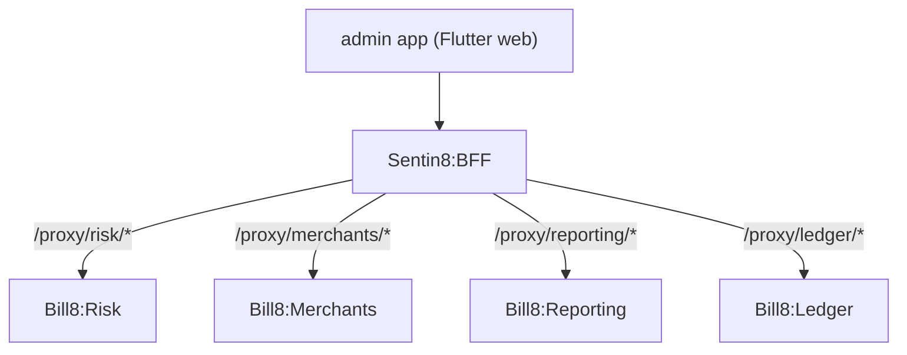

# Bill8:Admin - Flutter App

The platform operations dashboard: oversee accounts, review fraud, and
manage platform configuration.

## 1. Summary

Bill8:Admin is the staff-facing Flutter app for the bill8
vertical. It renders the admin/RFW surfaces of the vertical's services
in the platform dashboard, for platform operators.

## 2. Motivation

Platform operators need oversight of connected accounts, fraud reviews,
and platform configuration without touching the merchant surface.

## 3. Architecture & High-Level Design

## 4. Key Traits and Data Structures

- `Bff8ApiClient` - shared BFF client.
- Staff-only (SSO) access.

## 5. Rationale, Trade-offs, and Alternatives

- **BFF proxy only**; staff auth via operator SSO.

## 6. Internal Implementation & Invariants

- All calls route through `Bff8ApiClient`; staff-only.

## 7. Unresolved Questions / Future Designs

- See the vertical `backlog.md`.

---

**Architecture & Design:** bill8:admin and its underlying concepts were designed by [Hamid Jahanzad](https://www.linkedin.com/in/hamidjahanzad/).
